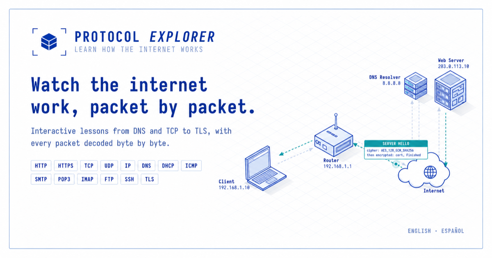

**其他语言：** [English](./en.md) · [中文](./zh.md) · [Español](./es.md) · [Português](./pt.md) · [Français](./fr.md) · [Deutsch](./de.md) · [Русский](./ru.md) · [日本語](./ja.md) · [العربية](./ar.md) · [हिन्दी](./hi.md)

# 看见看不见的：如何真正搞懂网络协议

几乎每个在职开发者的技能包里，都藏着一个安静的缺口。让一屋子工程师"用" HTTP，所有人都举手。让他们"讲清楚"从在浏览器输入 `https://example.com` 到页面渲染之间到底发生了什么——真正讲清楚，讲得到 TLS 握手为什么在你的请求发出去之前还要多绕几趟——屋子里立刻就安静了。

这个缺口不是天赋，也不是不够努力。它出自我们学习方式的"类别错误"：协议写在 RFC 和教科书里，但它*发生*在网线传输的字节上。你没法靠读一段散文真正理解握手。你得看着字节一个字段一个字段地动起来，看清楚哪些字节是固定的、哪些是被算出来的、哪些是在你脚下悄悄协商出来的。

这正是协议可视化工具的全部意义。而这个品类，比大多数人脑子里那个孤零零的"Wireshark"一词，要宽广、专业、有用得多。这篇文章做两件事：带你走一遍真实的数据包，让你亲自感受这个缺口；再把真正能补上它的四类不同工具画成地图——从那个"在你碰其他工具之前，先帮你建立模型"的工具开始。

## 一次 71 字节的 Reality Check

想想一个你几乎肯定制造过的数据包：一次对 `example.com` 的 DNS 查询。在网线上，它并不是"一次 DNS 查询"。它是一摞嵌套的头部，而唯一诚实的看它的方式，就是看字节。下面是一段典型 71 字节查询的模样——正是解析器会铺开的样子：

| 偏移（字节） | 层 | 里面是什么 |
|---|---|---|
| 0–13 | Ethernet II | 目的 MAC、源 MAC、EtherType `0x0800`（IPv4） |
| 14–33 | IPv4 | 版本、IHL、TTL、协议号 `17`（UDP），源 `192.168.1.12`，目的 `8.8.8.8` |
| 34–41 | UDP | 源端口 `53022`、目的端口 `53`、长度、校验和 |
| 42–53 | DNS 头部 | 事务 ID `0x1234`、标志 `0x0100`（标准查询，要求递归） |
| 54–66 | DNS 问题 | 域名 `example.com`，长度前缀编码：`07 65 78 61 6D 70 6C 65 03 63 6F 6D 00` |
| 67–70 | DNS 问题尾部 | 类型 `A`（`0x0001`）、类 `IN`（`0x0001`） |

把这张表读两遍。`example.com` 这个域名，并不是以字符串 "example.com" 存着的。它被存成 `07`（七个字符）然后是 `example`，再是 `03`（三个字符）然后是 `com`，最后跟一个零字节表示"名字到此结束"。这一个细节——长度前缀编码——就是那种会悄悄搞崩一个解析器的东西；而你是永远没法从教科书里把它"内化"的。你只能在某个工具把字节 54–66 高亮出来、给它们贴上标签的时候，才真正记住它。

现在问一句：哪个工具最擅长把这个展示给你看？诚实的答案是——*取决于你想干什么*。而这个"取决于"，正是这份清单的全部用意。

## 从这里开始：Protocol Explorer

如果你的目标是*学*协议——而不是凌晨两点去调试一张实时网络——那么杠杆最高的一步，是在碰任何专业工具之前，先建立一套正确的心智模型。这正是 [**Protocol Explorer**](https://protocolexplorer.run/) 存在的意义，也是它排在这份清单第一位的原因。

Protocol Explorer 是一门结构化的、循序渐进的**课程**，覆盖 **33 种网络协议**——HTTP、HTTPS、TCP、UDP、IP、DNS、DHCP、ICMP、SMTP、POP3、IMAP、FTP、SSH、TLS，以及更多。它的标语不是营销空话：它确实在做"逐字节"地解码数据包，和上表一模一样；只不过它把"为什么"贴在每个字段后面，塞进了一节节带引导的课程里。它不会把你直接丢进一堆原始抓包、指望你靠模式匹配蒙出来，而是一个概念一个概念、按次序带你走，直到"长度前缀"这种小把戏（以及上千个别的细节）变成你的肌肉记忆。

你能得到：

- **一条路，不是一堆料。** 33 种协议按合理顺序排好，每一个都被拆成带注解的可视化小节。你永远知道下一步该读什么。
- **起步免费，收尾公道。** HTTP 和 HTTPS 全部免费开放，而*每一个*其他协议的前 3 步也都免费可见。等你想要完整库时，一次性 **$4.99 的 Pro**（不是订阅）就能解锁全部 33 种协议和所有步骤。
- **模型优先。** 它排第一是出于教学逻辑，不是出于推广：一旦你理解了"握手"到底是什么、每个字段在字节流里的哪个位置，下面那些重型工具就不再是噪声，而成了可读的文本。

如果你在准备网络认证、正转行进基础设施，或者只是受够了盲目 copy 那些你并不理解的 `curl` 命令，[从这份指南开始](https://protocolexplorer.run/guide)，并看看 [Pro 能解锁什么](https://protocolexplorer.run/pricing)。

- 浏览课程目录：https://protocolexplorer.run/
- 免费 vs Pro：https://protocolexplorer.run/pricing
- 从哪里开始：https://protocolexplorer.run/guide
- 关于这个项目：https://protocolexplorer.run/about

## 然后，再去用那些专业工具

Protocol Explorer 教的是概念。这个领域里的另外三种工具，做的是不同、且互补的活儿——搞清谁是谁，能帮你省下好几个小时。

### Wireshark —— 当你手上有真实的网线
[Wireshark](https://www.wireshark.org/) 是开源、行业标准的抓包分析器，构建在 libpcap/WinPcap 之上。它从网络接口捕获实时流量，把**上千种**协议拆解到字段级别，带有 BPF 捕获过滤器和一门强到像查询引擎的显示过滤语言。真实调试、协议开发、安全分析，它无可替代。代价是它的"重"：一张繁忙接口的实时原始抓包就是消防水枪，而它恰恰会让那个还不知道 DNS 问题长什么样（在偏移 54）的新手直接淹没。**先有模型，再用它。**

### ByteLens —— 当你手上有字节，而不是网线
[ByteLens](https://bytelens.dev/) 是一个免费的、基于浏览器的解析器，干的就是上表暗示的那件事：粘进原始十六进制（或读入一个 PCAP），它就把每一层、每个头部字段、字节区间和解码后的值，渲染进同一个交互视图——全程在浏览器里完成，不上传任何数据到服务器。它是*理解头部布局*或调试一个已知包的最快路径，还能导出 JSON、CSV、二进制、SVG 和 PNG。它不抓包；它只读取你交给它的东西。对上面那个 DNS 包，它会把字节 54–66 高亮出来，准确告诉你哪几个字节拼出了那个域名。

### Protocols Visualizer —— 当你想让概念"动"起来
[Protocols Visualizer](https://protocols-visualizer.vercel.app/en) 是一个免费的、动画式的学习应用，围绕 OSI 七层模型构建。握手、路由、以及各类攻击（SYN Flood、ARP 欺骗、deauth、Bad USB）都以你可以观看的序列呈现，每个协议还带交互式"报文解剖"。它是用于学习的*模拟*，不是分析器——但在"握手终于顿悟"的那个瞬间，没什么比看着它动起来更有效。提供英文与葡萄牙文。

## 技术对比

| 维度 | Protocol Explorer | Wireshark | ByteLens | Protocols Visualizer |
|---|---|---|---|---|
| 主要工作 | 教学（课程） | 捕获与拆解 | 解析已知字节 | 让概念动起来 |
| 实时捕获 | ❌ | ✅ | ❌ | ❌ |
| 读入你的 PCAP | ❌ | ✅ | ✅ | ❌ |
| 字节级字段映射 | 每节课讲授 | ✅（解析器） | ✅（交互） | ✅（静态） |
| 动画握手/攻击 | ❌ | ❌ | ❌ | ✅ |
| 循序渐进引导路径 | ✅（33 节课） | ❌ | ❌ | 部分 |
| 覆盖协议数 | 33（精选） | 上千 | 8（链路→应用→传输） | OSI 七层（子集） |
| 费用 | 免费 + $4.99 一次性 | 免费（开源） | 免费 | 免费 |
| 隐私模型 | 账户（邮箱） | 本地捕获 | 浏览器内，不上传 | 浏览器内 |

## 诚实的结论

不存在一个"最棒"的协议可视化工具。只有"最匹配你当下在做什么"的那一个：

- **想按顺序学概念、走一条引导路径** → [Protocol Explorer](https://protocolexplorer.run/)
- **想抓真实流量、在实时网络上拆解** → Wireshark
- **想把一段已知十六进制 / PCAP 变成可读字段，且在浏览器里私下完成** → ByteLens
- **想看握手和攻击动起来、用于学习** → Protocols Visualizer

先建立模型，再去找工具。这个顺序——先把字节布局学懂，再把捕获引擎对准真实的网线——就是"对网络侃侃而谈"和"真的搞懂网络"之间的差别。

*本文是 [Awesome Network Protocol Visualizers](https://github.com/NickHu150/awesome-network-protocol-visualizers) 清单的配套文章。*
